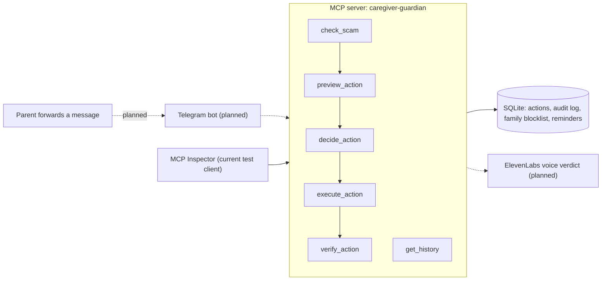

# Caregiver Guardian

A family safety assistant for elderly parents and their children who live elsewhere.
Built for **wHACKiest 2026, Track 1: Make MCP Matter**.

> **Status: working prototype. All data is synthetic. No real payments or real messages are sent.**

## The problem

Senior citizens are heavily targeted by digital fraud. Over 1 lakh senior citizens reported cyber-fraud losses of about Rs 4,005 crore in 2025 (Ministry of Home Affairs figures given to the Rajya Sabha, as reported in the press). Scam victims are often isolated from family, and children who live elsewhere cannot see what is happening.

## What it does

1. A suspicious message is checked by a rule-based scam checker. It returns a risk level and the reasons.
2. Before anything happens, the system **previews** the proposed action with its risk level and reasons.
3. The right person approves. Actions are routed by risk: **low-impact alerts can be approved by the parent, and everything else needs the child.** If nobody approves in time, the action is **cancelled, never released**.
4. After approval, the action runs through an MCP tool, is **verified**, and is written to an **audit log**.
5. Approved blocks are stored, and later checks flag them with the reason "on the family blocklist".

## Architecture



## MCP tools

| Tool | What it does |
|---|---|
| `check_scam` | Scores a message (urgency, authority claims, money or code requests, secrecy, links, blocklists) and returns the risk level, score and reasons. Deterministic rules, no AI model. |
| `preview_action` | Shows what an action would do, with risk level, reasons, who must approve, and an expiry time. Nothing runs. |
| `decide_action` | Approve or deny a pending action. Refuses the wrong approver, and expires late approvals. |
| `execute_action` | Runs an **approved** action only. Refuses anything else. |
| `verify_action` | Checks that the action really took effect. |
| `get_history` | Shows the audit log, newest first. |
| `ping` | Health check. |

Supported actions: `notify_child` (simulated alert), `block_item` (adds a link, UPI ID or phone to the family blocklist), `create_reminder`.

## Control design

- **Prepare, don't pay.** The system never moves money.
- **Approval routing:** parent for low-impact alerts, child for everything else.
- **Expiry:** the default window is 10 minutes (`APPROVAL_MINUTES` environment variable). Expired requests are cancelled, not run.
- **Audit log:** every preview, decision, refusal, execution and verification is recorded.

## Status

| Feature | Status |
|---|---|
| MCP server and `ping` | Working, tested manually |
| `check_scam` | Working, tested manually on sample messages |
| Preview, decide, execute, verify, history | Working, tested manually |
| Child-only approval rule (parent refused) | Working, tested manually |
| Approval expiry | Implemented, not yet tested |
| Parent approval of low-impact alerts | Implemented, not yet tested |
| Telegram bot | Planned |
| ElevenLabs voice verdict | Planned |
| Backup approver when the child is busy | Planned |
| Daily brief of the parent's bills and deadlines | Planned |
| Scoring evaluation on a larger message set | Not yet done |

## Test results (manual, in MCP Inspector)

| Test | Expected | Actual | Status |
|---|---|---|---|
| `check_scam`: scam message with authority, urgency, money, secrecy and a blocklisted UPI ID | High risk with those reasons | High, score 100, all five reasons | Pass |
| `preview_action`: block UPI ID `pay.now@fakebank` | Pending, child approval needed | Pending, risk high (3 reasons), needs child approval, 10-minute expiry (see note) | Pass |
| `decide_action` as parent on a child-only action | Refused | Error: "This action needs the child's approval" | Pass |
| `decide_action` as child | Approved | Status approved | Pass |
| `execute_action` | Executed | Executed, UPI ID added to the blocklist | Pass |
| `verify_action` | Verified | `verified: true` | Pass |
| `check_scam` on the same message afterwards | Blocklist reason appears | High, score 95, "UPI ID is on the family blocklist" | Pass |
| `preview_action`: reminder with no message | Pending, child approval, risk unknown | Pending, risk unknown, child approval needed | Pass |

Note: the UPI ID was already on the blocklist from an earlier run (the local database persists), so the first preview scored high.

Also run manually and reported as passing, with outputs not yet captured: `check_scam` on a genuine bank alert, a blocklisted link and an empty message; refusal to execute an unapproved action; and `get_history`.

## Setup (Windows, PowerShell)

```
git clone https://github.com/Lochang03/caregiver-guardian.git
cd caregiver-guardian
python -m venv .venv
.venv\Scripts\activate
pip install -r requirements.txt
mcp dev server/main.py
```
`mcp dev` opens the MCP Inspector in your browser (it needs Node.js). Click **Connect**, open the **Tools** tab, and run the tools. If the Inspector reports that `uv` is not recognized, run `pip install uv` and start it again.

## Data

All data is synthetic. `data/blocklist.json` holds fake domains, UPI IDs and phone numbers. The local database `data/guardian.db` is created on first run and is not committed. To reset the demo state, delete `data/guardian.db`.

## Limitations

- A prototype. No real payments, and the child alert is simulated.
- It cannot stop a victim who is coached to pay through another app.
- Approvers are not authenticated yet. In a real system, the child's approval would come from their own verified device.
- The scoring weights are placeholders and have not been tested on a large message set.
- The keyword lists are mostly English with a few Hindi words. Kannada is not covered yet.
- Existing tools such as Google's scam detection, Sanchar Saathi and UPI Circle already cover parts of this space. This project focuses on the family approval and audit layer around them.