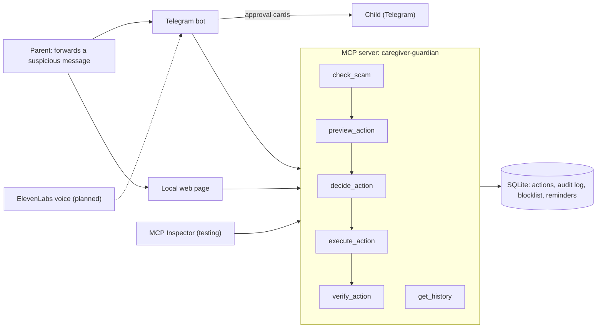

# Caregiver Guardian

A family safety assistant for elderly parents and their children who live elsewhere.
Built for **wHACKiest 2026, Track 1: Make MCP Matter**.

> **Status: working prototype. All data is synthetic. No real payments or real messages are sent.**

## The problem

Senior citizens are heavily targeted by digital fraud. Over 1 lakh senior citizens reported cyber-fraud losses of about Rs 4,005 crore in 2025 (Ministry of Home Affairs figures given to the Rajya Sabha, as reported in the press). Scam victims are often isolated from family, and children who live elsewhere cannot see what is happening.

## What it does

1. A suspicious message is checked by a rule-based scam checker, which returns a risk level and the reasons.
2. Before anything happens, the system **previews** the proposed action with its risk level and reasons.
3. The right person approves. Actions are routed by risk: **low-impact alerts can be approved by the parent, and everything else needs the child.** If nobody approves in time, the action is **cancelled, never released**.
4. After approval, the action runs through an MCP tool, is **verified**, and is written to an **audit log**.
5. Approved blocks are stored, and later checks flag them with the reason "on the family blocklist".

The system never moves money. It prepares and records, and people decide.

## Ways to use it

| Interface | What it is |
|---|---|
| **Telegram bot** (`bot/telegram_bot.py`) | The parent sends a message to the bot and gets a verdict. Approval cards go to the child. It talks to the MCP server as a real MCP client |
| **Local web page** (`web/app.py`) | One page that does the same flow in a browser, with no internet needed |
| **MCP Inspector** | The manual test tool for the MCP server |

## Architecture



## MCP tools

| Tool | What it does |
|---|---|
| `check_scam` | Scores a message (urgency, authority claims, money or code requests, secrecy, links, blocklists) and returns the risk level, score and reasons. Deterministic rules, no AI model. |
| `preview_action` | Shows what an action would do, with risk level, reasons, who must approve, and an expiry time. Nothing runs. |
| `decide_action` | Approve or deny a pending action. Refuses the wrong approver, and expires late approvals. |
| `execute_action` | Runs an **approved** action only. Refuses anything else. |
| `verify_action` | Checks that the action really took effect. |
| `get_history` | Shows the audit log, newest first. |
| `ping` | Health check. |

Supported actions: `notify_child` (simulated alert), `block_item` (adds a link, UPI ID or phone to the family blocklist), `create_reminder`.

## Control design

- **Prepare, don't pay.** The system never moves money.
- **Approval routing:** parent for low-impact alerts, child for everything else.
- **Expiry:** the default window is 10 minutes (`APPROVAL_MINUTES` environment variable). Expired requests are cancelled, not run.
- **Audit log:** every preview, decision, refusal, execution and verification is recorded.
- **Telegram roles:** with `CHILD_CHAT_ID` set in `.env`, approval cards go only to the child's chat, and the presser is treated as the child only if their Telegram ID matches. Without it, the bot runs in single-chat demo mode and shows role buttons so one person can play both roles.

## Status

| Feature | Status |
|---|---|
| MCP server and all tools | Working, tested manually in the MCP Inspector |
| `check_scam` | Working, tested manually on sample messages |
| Preview, decide, execute, verify, history | Working, tested manually |
| Child-only approval rule (parent refused) | Working, tested in the Inspector |
| Telegram bot: verdict, approval cards, child approval, execution | Working, tested manually |
| Telegram two-person mode (`CHILD_CHAT_ID`) | Working, tested manually |
| Local web page | Working |
| Approval expiry | Implemented, not yet tested |
| Parent approval of low-impact alerts | Implemented, not yet tested |
| ElevenLabs voice verdict | Planned |
| Backup approver when the child is busy | Planned |
| Daily brief of the parent's bills and deadlines | Planned |
| Evaluation on a larger message set | Not yet done |

## Test results (manual)

| Test | Expected | Actual | Status |
|---|---|---|---|
| `check_scam`: scam message with authority, urgency, money, secrecy and a blocklisted UPI ID | High risk with those reasons | High, score 100, all five reasons | Pass |
| `preview_action`: block UPI ID `pay.now@fakebank` | Pending, child approval needed | Pending, risk high, needs child approval, 10-minute expiry | Pass |
| `decide_action` as parent on a child-only action | Refused | Error: "This action needs the child's approval" | Pass |
| `decide_action` as child | Approved | Status approved | Pass |
| `execute_action` | Executed | Executed, UPI ID added to the blocklist | Pass |
| `verify_action` | Verified | `verified: true` | Pass |
| `check_scam` on the same message afterwards | Blocklist reason appears | "UPI ID is on the family blocklist" added | Pass |
| `preview_action`: reminder with no message | Pending, child approval, risk unknown | As expected | Pass |
| Telegram: forward the sample scam message | High risk verdict with reasons, plus two approval cards | As expected (screenshots in `docs/`) | Pass |
| Telegram: child approves the block card | Executed and verified | As expected | Pass |

Note: the local database keeps data between runs, so a UPI ID blocked in an earlier run is flagged immediately. To reset the demo state, delete `data/guardian.db`.

## Setup (Windows, PowerShell)

```
git clone https://github.com/Lochang03/caregiver-guardian.git
cd caregiver-guardian
python -m venv .venv
.venv\Scripts\activate
pip install -r requirements.txt
```
If `python-telegram-bot` is not installed by that step, run `pip install python-telegram-bot`.

**Test the MCP server:** `mcp dev server/main.py` opens the MCP Inspector in your browser (it needs Node.js). Click **Connect**, open the **Tools** tab, and run the tools. If the Inspector says `uv` is not recognized, run `pip install uv` and start it again.

**Run the web page:** `python web/app.py`, then open http://127.0.0.1:8000

**Run the Telegram bot:**
1. Create a bot with @BotFather and copy its token.
2. Create a file named `.env` in the project root (it is git-ignored, and never commit it):
   ```
   TELEGRAM_BOT_TOKEN=your-token
   CHILD_CHAT_ID=
   ```
3. Run `python bot/telegram_bot.py`, then send `/start` to your bot.
4. **Two-person mode (optional):** the child opens the bot, presses Start, and sends `/myid`. Put the number in `CHILD_CHAT_ID` in `.env`, and restart the bot.

If the bot times out on your network, it already ignores Windows system proxy settings (`trust_env=False`). On a network that requires a proxy, remove that setting in `main()`.

## Data

All data is synthetic. `data/blocklist.json` holds fake domains, UPI IDs and phone numbers. The local database `data/guardian.db` is created on first run and is not committed.

## What's next

| Next step | Why |
|---|---|
| **ElevenLabs voice** | Transcribe the parent's voice notes and speak the verdict in their language (the vendor lists Hindi and Kannada support, and we have not tested its quality yet). We chose ElevenLabs as our sponsor technology |
| Authenticate the parent (a `PARENT_CHAT_ID` allowlist) | Today any account can message the bot as a parent |
| Tell the parent when the child decides | Today the parent is not notified |
| Send alerts automatically, and ask approval only for actions that change something | Today the alert asks for approval, which is awkward |
| Backup approver if the child doesn't respond | Right now an unanswered request just expires |
| Daily brief of the parent's synthetic bills and deadlines | Makes the daily use clearer |
| A real external app through MCP, such as Google Calendar reminders after approval | Today every action is local |
| A first-hour incident pack for reporting fraud | Helps the family act quickly |
| Evaluate the scoring on a larger message set | The weights are placeholders so far |
| Real approver authentication on the child's own device | The current check is a Telegram ID |

## Limitations

- A prototype on synthetic data. No real payments are made, and the child alert is simulated.
- It cannot stop a victim who is coached to pay through another app. It adds a family approval and audit layer alongside existing tools such as Google's scam detection, Sanchar Saathi and UPI Circle.
- In Telegram two-person mode the child is identified by Telegram ID, but the parent is not authenticated yet (see What's next).
- The scoring weights are placeholders, tested only on a few sample messages. The keywords are mostly English with a few Hindi words, and Kannada is not covered yet.